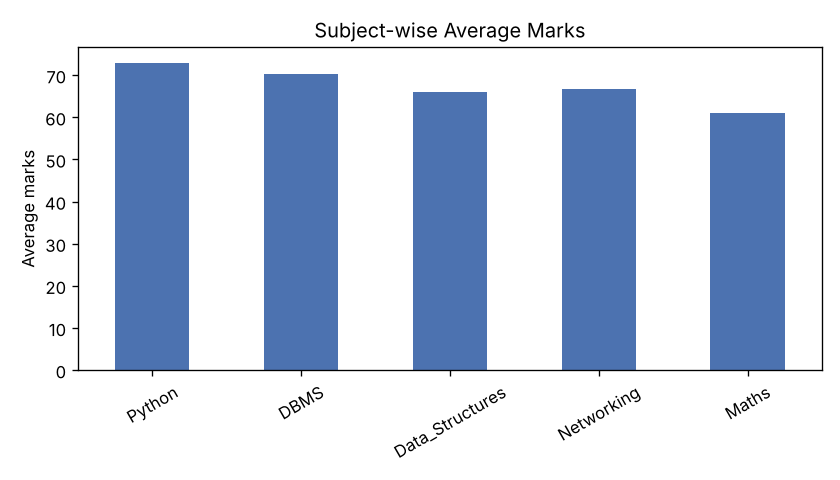
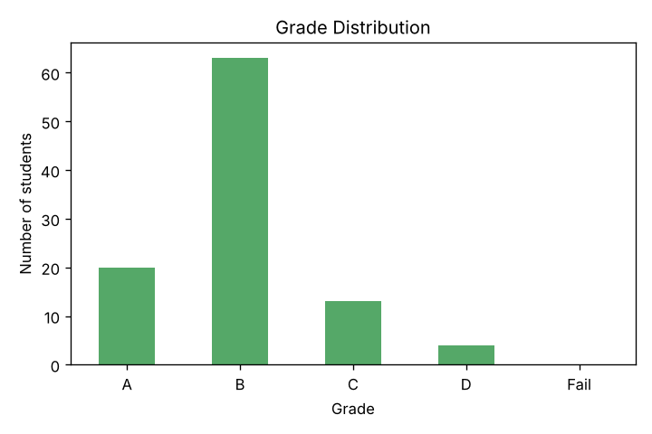
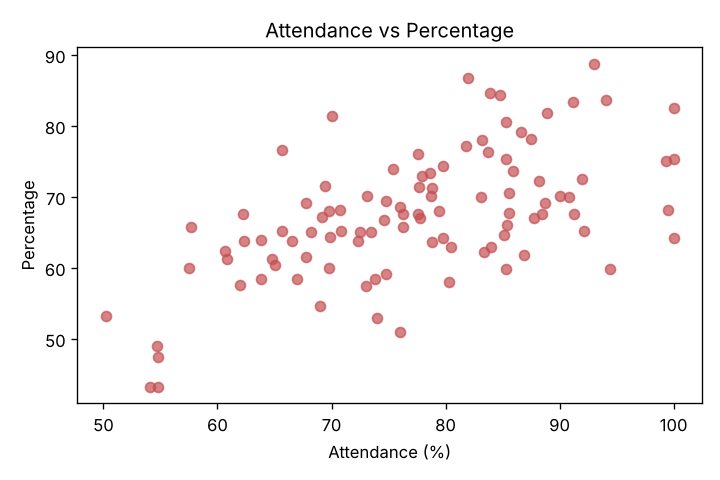
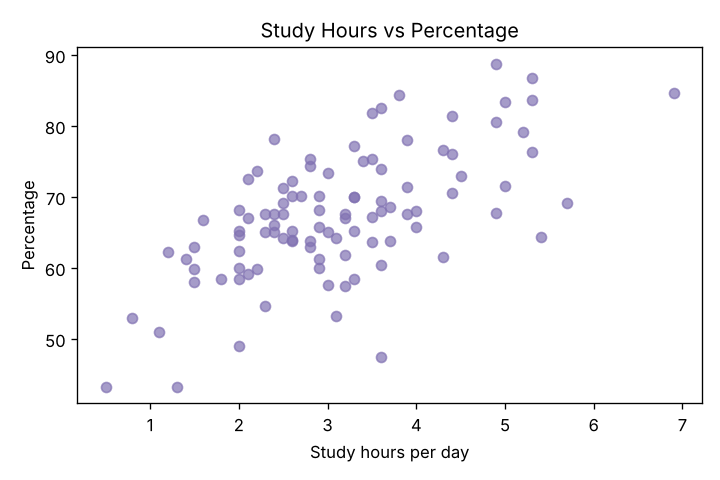

# 📊 Student Marks Analysis

A beginner-friendly **data analysis project in Python** using **Pandas** and **Matplotlib**.
It analyses the marks of 100 MCA students and finds patterns like subject-wise performance,
grade distribution, and how attendance and study hours affect results.

## ✨ What this project does
- Loads and **cleans** the data (fills missing marks)
- Calculates **total, percentage and grade** for each student
- Finds **top 5 students** and **subject-wise averages**
- Calculates the **pass percentage**
- Finds the **correlation** between attendance / study hours and marks
- Creates **4 charts** and saves the final result in `results.csv`

## 🛠 Built With
- Python 🐍
- Pandas
- Matplotlib
- NumPy

## 📁 Project Structure
```
student-marks-analysis/
├── analysis.py          # main analysis script
├── generate_data.py     # creates the sample dataset
├── student_marks.csv    # dataset (100 students)
├── results.csv          # output after analysis
├── requirements.txt
└── images/              # generated charts
```

## ▶️ How to Run
1. Clone the repo:
   ```bash
   git clone https://github.com/akankshasingh7110-cloud/student-marks-analysis.git
   cd student-marks-analysis
   ```
2. Install the libraries:
   ```bash
   pip install -r requirements.txt
   ```
3. Run the analysis:
   ```bash
   python analysis.py
   ```

## 📸 Charts

| Subject-wise Average | Grade Distribution |
|---|---|
|  |  |

| Attendance vs Percentage | Study Hours vs Percentage |
|---|---|
|  |  |

## 🔍 Key Findings
- **Python** has the highest average marks, **Maths** has the lowest.
- Most students fall in **Grade B**.
- Students with **higher attendance and more study hours** score better (positive correlation).

## 📝 Note
The dataset is **sample data generated by `generate_data.py`** for learning purposes,
not real student records. You can replace `student_marks.csv` with any real dataset
(for example from Kaggle) and adjust the subject names in `analysis.py`.

## 👩‍💻 Author
**Akanksha Singh Kushwaha**
GitHub: [@akankshasingh7110-cloud](https://github.com/akankshasingh7110-cloud)
